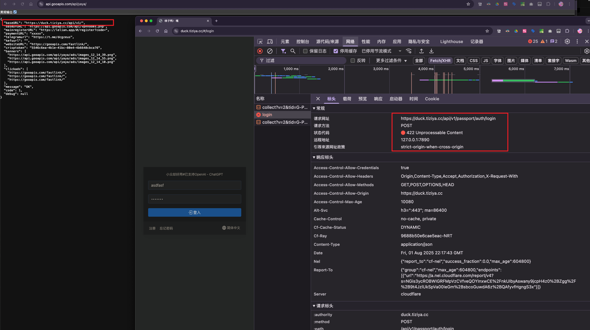
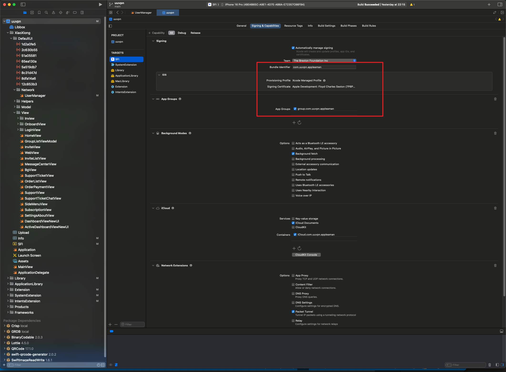
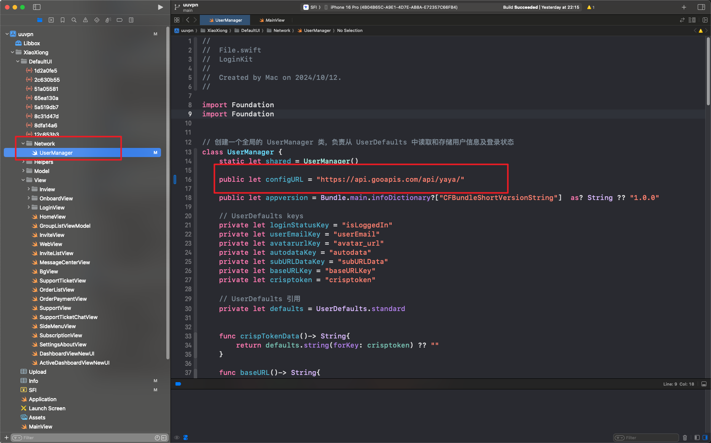

# UUVPN iOS SwiftUI Application

**Language**: [English](README.md) | [中文](README_CN.md)

A professional iOS VPN application built with SwiftUI, designed to integrate seamlessly with V2Board panel APIs. This application provides a modern, intuitive interface for VPN management with comprehensive configuration options.

## 🚀 Features

- **Modern SwiftUI Interface**: Responsive design that adapts to different screen sizes
- **Dark/Light Mode Support**: Automatic theme synchronization with system preferences
- **V2Board API Integration**: Complete integration with V2Board panel APIs
- **Network Management**: Advanced networking capabilities using `URLSession`
- **Background Updates**: Automatic profile updates with background task scheduling
- **Multi-platform Support**: iOS 15.0+ with macOS compatibility

## 📋 Requirements

Before getting started, ensure your development environment meets the following requirements:

- **Xcode**: 14.0 or later
- **iOS Deployment Target**: 15.0 or later
- **Swift**: 5.7+
- **Network Access**: VPN required for Swift Package Manager dependencies

## 🏗️ Project Structure

```
iOS-SwiftUI-Code/
├── ApplicationLibrary/          # Core application library
│   ├── Service/                 # API services and managers
│   │   ├── StoreManager.swift   # Configuration storage manager
│   │   └── ProfileUpdateTask.swift # Background update tasks
│   ├── Views/                   # SwiftUI view components
│   │   ├── Dashboard/           # Dashboard interface
│   │   ├── Profile/             # Profile management
│   │   └── Setting/             # Settings interface
│   └── Assets.xcassets/         # Application assets
├── XiaoXiong/                   # Main application target
│   ├── DefaultUI/               # Default UI components
│   └── Info.plist               # Application configuration
├── Extension/                   # Network extension
├── SystemExtension/             # System extension for macOS
├── uuvpn.xcodeproj             # Xcode project file
└── README.md                   # Project documentation
```

## ⚙️ Installation & Setup

### 1. Clone the Repository

```bash
git clone https://github.com/nicolastinkl/UUVPN/tree/main/iOS-SwiftUI-Code
cd iOS-SwiftUI-Code
```

### 2. Install Dependencies

The project uses Swift Package Manager for dependency management. **Note: VPN connection required for package resolution.**

```bash
# Dependencies will be automatically resolved when opening the project
```

### 3. Open Project in Xcode

```bash
open uuvpn.xcodeproj
```

Select your target device or simulator and click the **Run** button.

## 🔧 V2Board API Configuration

### Base Configuration

The app reads its API and page URLs from a remote JSON document. Set only `configURL` in [`UserManager.swift`](XiaoXiong/DefaultUI/Network/UserManager.swift); the other URLs are supplied by that document.



#### Configuration URL
```swift
public let configURL = "https://download.uuvpn2026.top/vpn.php"
```

### API Endpoints Configuration

The response must contain `code: 1` and a `baseURL` using HTTPS whose path ends in `/api/v1/`. This is the smallest valid response:

```json
{
  "baseURL": "https://x.fengche.im/api/v1/",
  "code": 1
}
```

Registration, payment, support, website, and other optional values come directly from this JSON. Missing values remain empty; the app does not fall back to `x.fengche.im`.

### API Field Descriptions

| Field | Description | Usage |
|-------|-------------|-------|
| `baseURL` | Required HTTPS panel API URL ending in `/api/v1/` | Main API requests |
| `code` | Required value `1` | Configuration validation |
| `baseDYURL` | Optional URL for a complete fallback sing-box configuration; not a node-list API | Fallback profile loading |
| `mainregisterURL` | Optional registration page URL with referral code prefix | User onboarding |
| `paymentURL` | Optional payment page URL | Payment flow |
| `telegramurl` | Optional Telegram support channel | Customer support |
| `kefuurl` | Optional customer service page URL | Online support |
| `websiteURL` | Optional website URL | General information |
| `crisptoken` | Optional Crisp website ID | Live chat integration |
| `message` | Optional response message | Status display |

### API Request Headers

All API requests include the following headers for authentication and tracking:

```swift
request.addValue("application/json", forHTTPHeaderField: "Content-Type")
request.addValue(Bundle.main.bundleIdentifier ?? "", forHTTPHeaderField: "bid")
request.addValue(UserManager.shared.appversion, forHTTPHeaderField: "appver")
```

## 🆔 Bundle Identifier (BID) Configuration

### Understanding Bundle Identifier

The Bundle Identifier (BID) is crucial for app identification and API authentication. It's referenced throughout the codebase as `Bundle.main.bundleIdentifier`.

### Current BID Configuration

Based on the [`Info.plist`](XiaoXiong/Info.plist:7) analysis, the current BID pattern is:
```
com.uuvpn.appleaman
```

### Modifying Bundle Identifier

To change the Bundle Identifier for your deployment:



#### 1. Update Xcode Project Settings
1. Open `uuvpn.xcodeproj` in Xcode
2. Select the project root in the navigator
3. Choose your target (e.g., "SFI", "SFM", "SFT")
4. Navigate to **General** → **Identity**
5. Update the **Bundle Identifier** field

#### 2. Update Info.plist References
Search and replace all BID references in configuration files:

```bash
# Search for current BID references
grep -r "com.uuvpn.appleaman" .

# Update the following files:
# - XiaoXiong/Info.plist
# - Extension/Info.plist  
# - SystemExtension/Info.plist
# - IntentsExtension/Info.plist
```

#### 3. Update Code References
The BID is automatically retrieved via `Bundle.main.bundleIdentifier` in:
- [`Login.swift`](XiaoXiong/DefaultUI/View/LoginView/Login.swift:494)
- [`HomeView.swift`](XiaoXiong/DefaultUI/View/HomeView.swift:984)

No code changes required as it uses the system bundle identifier.

### BID Validation in API

The server can validate requests using the BID header to ensure API calls come from authorized applications.

## 💳 Payment URL Logic & App Store Compliance

### Payment URL Length Detection

The application implements intelligent payment handling based on the `paymentURL` field length:

```swift
// Apple Review Mode Detection
if (paymentURLKey.count > 3) {
    // Normal payment mode - show external payment options
    // Enable subscription features
    // Show payment buttons and pricing
} else {
    // Apple Review Mode - hide external payments
    // Comply with App Store guidelines
    // Hide sensitive payment information
}
```

### Implementation Details

#### Normal Mode (paymentURL.length > 3)
- **External Payment**: Direct users to web-based payment systems
- **Full Feature Access**: All subscription features available
- **Payment Integration**: Complete payment flow with external providers

#### Apple Review Mode (paymentURL.length ≤ 3)
- **Compliance Mode**: Hides external payment options
- **Limited Features**: Restricted functionality during review
- **App Store Guidelines**: Complies with Apple's payment policies

### Code Implementation

The logic is implemented across multiple view files:

- [`HomeView.swift`](XiaoXiong/DefaultUI/View/HomeView.swift:125): Main payment UI logic
- [`SideMenuView.swift`](XiaoXiong/DefaultUI/View/SideMenuView.swift:119): Menu payment options
- [`ActiveDashboardViewNewUI.swift`](XiaoXiong/DefaultUI/View/ActiveDashboardViewNewUI.swift:217): Dashboard payment handling

### Server-Side Configuration

Configure your initialization endpoint to return:

```json
{
  "paymentURL": "https://your-payment-gateway.com/pay",  // Normal mode
  // OR
  "paymentURL": "xx",  // Apple review mode
}
```

## 🔄 Initialization Endpoint Configuration

### Endpoint Setup

On startup, the app requests `configURL`, validates the JSON, then stores the resulting URLs. A valid cached response can be used while offline. On a first launch with no valid network response or cache, the app shows a retry option.



#### Recommended Hosting
- **Alibaba Cloud OSS**: Faster response times in China
- **CDN Integration**: Global content delivery
- **HTTPS Required**: Secure configuration delivery

### Configuration Response Format

```json
{
  "code": 1,
  "baseURL": "https://x.fengche.im/api/v1/",
  "mainregisterURL": "https://x.fengche.im/#/register?code=",
  "paymentURL": "https://x.fengche.im/",
  "telegramurl": "https://t.me/your-support-channel",
  "kefuurl": "https://x.fengche.im/",
  "websiteURL": "https://x.fengche.im/",
  "crisptoken": "your-crisp-website-id",
  "message": "OK"
}
```

Only `code` and `baseURL` are required. Omit any optional field you do not use; an omitted value has no hard-coded domain fallback. Add `baseDYURL` only if you provide a complete fallback sing-box configuration, not `/api/v1/user/server/fetch`.

### Error Handling

```json
{
  "message": "Configuration Error",
  "code": 0,
  "error": "Invalid request"
}
```

### Caching Strategy

[`UserManager`](XiaoXiong/DefaultUI/Network/UserManager.swift) restores a cached response only when it has `code: 1`, a valid HTTPS `baseURL` ending in `/api/v1/`, and a source marker matching the current `configURL`. Older caches without this marker are ignored. If the app is offline with no valid cache, it shows Retry instead of entering the app.

## 🔐 Security Considerations

### API Security
- **HTTPS Only**: All API endpoints must use HTTPS
- **Token Validation**: Implement proper token validation
- **Rate Limiting**: Protect against API abuse

### Bundle Identifier Security
- **Unique BID**: Use a unique bundle identifier for your deployment
- **Server Validation**: Validate BID on server-side for API requests
- **Certificate Pinning**: Consider implementing certificate pinning

## 🚀 Deployment Guide

### Pre-Deployment Checklist

1. **Update Bundle Identifier**: Change from default BID
2. **Configure API Endpoints**: Set up your V2Board panel URLs
3. **Test Payment Logic**: Verify both normal and review modes
4. **Update App Icons**: Replace default icons with your branding
5. **Configure Push Notifications**: Set up notification certificates

### Build Configuration

```bash
# Clean build folder
rm -rf ~/Library/Developer/Xcode/DerivedData

# Archive for distribution
xcodebuild archive \
  -project uuvpn.xcodeproj \
  -scheme YourSchemeName \
  -archivePath YourApp.xcarchive
```

## 🤝 Contributing

We welcome contributions to improve the application. Please follow these guidelines:

1. Fork the repository
2. Create a feature branch
3. Make your changes
4. Submit a pull request

## 📄 License

This project is licensed under the MIT License. See the LICENSE file for details.

## 📞 Support

For technical support and questions:

- **GitHub Issues**: [Create an issue](https://github.com/nicolastinkl/UUVPN/issues)
- **Documentation**: Refer to the deployment documentation in the project
- **Community**: Join our developer community for assistance

---

**Note**: This application requires proper V2Board panel setup and valid API endpoints to function correctly. Ensure your backend infrastructure is properly configured before deployment.
