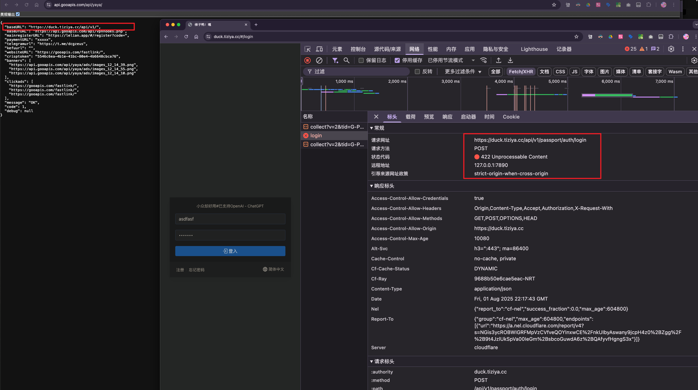
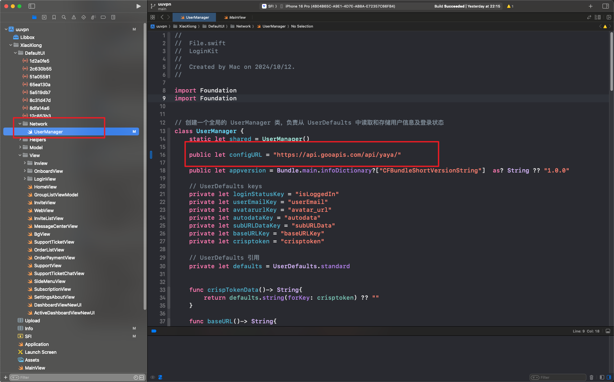

# UUVPN iOS SwiftUI 应用程序

**语言**: [English](README.md) | [中文](README_CN.md)

一个专业的 iOS VPN 应用程序，使用 SwiftUI 构建，专为与 V2Board 面板 API 无缝集成而设计。该应用程序为 VPN 管理提供现代化、直观的界面和全面的配置选项。

## 🚀 功能特性

- **现代化 SwiftUI 界面**：响应式设计，适配不同屏幕尺寸
- **深色/浅色模式支持**：与系统主题自动同步
- **V2Board API 集成**：与 V2Board 面板 API 完整集成
- **网络管理**：使用 `URLSession` 的高级网络功能
- **后台更新**：通过后台任务调度自动更新配置文件
- **多平台支持**：iOS 15.0+ 并兼容 macOS

## 📋 环境要求

在开始之前，请确保您的开发环境满足以下要求：

- **Xcode**：14.0 或更高版本
- **iOS 部署目标**：15.0 或更高版本
- **Swift**：5.7+
- **网络访问**：Swift Package Manager 依赖项需要 VPN 连接

## 🏗️ 项目结构

```
iOS-SwiftUI-Code/
├── ApplicationLibrary/          # 核心应用程序库
│   ├── Service/                 # API 服务和管理器
│   │   ├── StoreManager.swift   # 配置存储管理器
│   │   └── ProfileUpdateTask.swift # 后台更新任务
│   ├── Views/                   # SwiftUI 视图组件
│   │   ├── Dashboard/           # 仪表板界面
│   │   ├── Profile/             # 配置文件管理
│   │   └── Setting/             # 设置界面
│   └── Assets.xcassets/         # 应用程序资源
├── XiaoXiong/                   # 主应用程序目标
│   ├── DefaultUI/               # 默认 UI 组件
│   └── Info.plist               # 应用程序配置
├── Extension/                   # 网络扩展
├── SystemExtension/             # macOS 系统扩展
├── uuvpn.xcodeproj             # Xcode 项目文件
└── README.md                   # 项目文档
```

## ⚙️ 安装与设置

### 1. 克隆仓库

```bash
git clone https://github.com/nicolastinkl/UUVPN/tree/main/iOS-SwiftUI-Code
cd iOS-SwiftUI-Code
```

### 2. 安装依赖

项目使用 Swift Package Manager 进行依赖管理。**注意：需要 VPN 连接才能解析包。**

```bash
# 打开项目时会自动解析依赖项
```

### 3. 在 Xcode 中打开项目

```bash
open uuvpn.xcodeproj
```

选择目标设备或模拟器，然后点击 **运行** 按钮。

## 🔧 V2Board API 配置

### 基础配置

应用从远程 JSON 读取 API 与页面地址。只需在 [`UserManager.swift`](XiaoXiong/DefaultUI/Network/UserManager.swift) 中配置 `configURL`，其余地址由该 JSON 提供。



#### 配置 URL
```swift
public let configURL = "https://download.uuvpn2026.top/vpn.php"
```

### API 端点配置

响应必须包含 `code: 1`，以及使用 HTTPS、路径以 `/api/v1/` 结尾的 `baseURL`。最小有效响应如下：

```json
{
  "baseURL": "https://x.fengche.im/api/v1/",
  "code": 1
}
```

注册、支付、客服、网站等可选地址直接来自这份 JSON。缺失字段保持为空，不再回退到 `x.fengche.im`。

### API 字段说明

| 字段 | 描述 | 用途 |
|------|------|------|
| `baseURL` | 必填，HTTPS 面板 API 地址，以 `/api/v1/` 结尾 | 主要 API 请求 |
| `code` | 必填，值为 `1` | 配置校验 |
| `baseDYURL` | 可选，完整 sing-box 备用配置的地址；不是节点列表接口 | 备用配置加载 |
| `mainregisterURL` | 可选，带推荐码前缀的注册页面地址 | 用户引导 |
| `paymentURL` | 可选，支付页面地址 | 支付流程 |
| `telegramurl` | 可选，Telegram 客服频道 | 客户支持 |
| `kefuurl` | 可选，客服页面地址 | 在线支持 |
| `websiteURL` | 可选，网站地址 | 一般信息 |
| `crisptoken` | 可选，Crisp 网站 ID | 在线聊天 |
| `message` | 可选，响应消息 | 状态显示 |

### API 请求头

所有 API 请求都包含以下用于身份验证和跟踪的请求头：

```swift
request.addValue("application/json", forHTTPHeaderField: "Content-Type")
request.addValue(Bundle.main.bundleIdentifier ?? "", forHTTPHeaderField: "bid")
request.addValue(UserManager.shared.appversion, forHTTPHeaderField: "appver")
```

## 🆔 换账号签名（iOS）

如果用另一个 Apple Developer 账号给 IPA 签名，先在**最终签名账号**中准备标识和权限。推荐在该账号下重新 Archive、导出；若使用重签工具，也必须满足相同的配置要求。只替换证书或取消勾选 App Groups，会导致“无法访问共享容器”或 VPN 启动失败。

`App Groups` 不能取消：主 App、Packet Tunnel 扩展和当前的配置数据库、节点文件及 Libbox 通信都依赖它。若最终账号是不同的 Team ID，必须新建该团队拥有的组并让所有相关目标使用同一个组；只有同一 Team ID 下的不同登录账号才可以继续使用原组。

1. 在项目的 iOS 构建配置中设置 `APP_BUNDLE_IDENTIFIER`（主 App 的 Bundle ID，例如 `com.example.uuvpn`）。默认 `APP_GROUP_IDENTIFIER` 为 `group.$(APP_BUNDLE_IDENTIFIER)`；如使用另一个组，在构建时显式设置。最终账号须注册主 App、Packet Tunnel 扩展和 Intents 扩展的 Bundle ID；扩展 ID 必须以主 App ID 加 `.` 为前缀。
2. 在最终账号的 Apple Developer 后台注册该 App Group，将**主 App 和 Packet Tunnel 扩展**都关联到同一个组。使用 Intents 共享数据时，也给 Intents 扩展关联该组。为 Packet Tunnel 扩展开通 Network Extensions 的 `packet-tunnel-provider` 权限，并使其签名描述文件包含该权限。主 App 的 Network Extensions 权限也要与工程的 entitlement 和描述文件一致。
3. 在构建设置中把 `ICLOUD_CONTAINER_IDENTIFIER` 指向最终账号拥有的 iCloud 容器（默认值为 `iCloud.$(APP_BUNDLE_IDENTIFIER)`），并把 `XiaoXiong/Info.plist` 中 `NSUbiquitousContainers` 下的容器键同步改成同一值；或在确认不使用 iCloud 功能后从目标能力、Info.plist 及 entitlement 中移除。另核对 Wi-Fi 信息等已启用能力是否由最终账号的描述文件允许。原账号的 App Group 和 iCloud 容器不会因为重签自动归属新账号。
4. 主 App、`PlugIns` 中的 Packet Tunnel 和 Intents 扩展都必须由最终账号签名，并分别嵌入对应的描述文件。重签工具若改 Bundle ID，也须同步更新三个目标、组标识、相关 entitlement 和签名；不能只改主 App。工程会从已安装的 Packet Tunnel 扩展读取其 Bundle ID，并在运行时使用签名允许且可访问的共享组。
5. 在**最终安装的 IPA** 上检查签名。解包后，对 `Payload/*.app` 及其 `PlugIns/*.appex` 分别执行 `codesign -d --entitlements :- <路径>`，检查 `embedded.mobileprovision`（`security cms -D -i <路径>/embedded.mobileprovision`）。核对 `application-identifier` 的 Team ID、各 Bundle ID、`com.apple.security.application-groups` 和 `com.apple.developer.networking.networkextension`；共享组必须在主 App 与 Packet Tunnel 的签名权限及描述文件中一致。原始导出 IPA 的检查结果不能代表重签后的安装包。

API 的 `bid` 请求头使用**最终安装的主 App Bundle ID**。如果服务端校验 `bid`，也要将新 ID 加入服务端允许列表。

## 💳 支付 URL 逻辑与 App Store 合规性

### 支付 URL 长度检测

应用程序基于 `paymentURL` 字段长度实现智能支付处理：

```swift
// Apple 审核模式检测
if (paymentURLKey.count > 3) {
    // 正常支付模式 - 显示外部支付选项
    // 启用订阅功能
    // 显示支付按钮和价格
} else {
    // Apple 审核模式 - 隐藏外部支付
    // 符合 App Store 指南
    // 隐藏敏感支付信息
}
```

### 实现详情

#### 正常模式 (paymentURL.length > 3)
- **外部支付**：引导用户到基于网页的支付系统
- **完整功能访问**：所有订阅功能可用
- **支付集成**：与外部提供商的完整支付流程

#### Apple 审核模式 (paymentURL.length ≤ 3)
- **合规模式**：隐藏外部支付选项
- **功能限制**：审核期间功能受限
- **App Store 指南**：符合 Apple 的支付政策

### 代码实现

该逻辑在多个视图文件中实现：

- [`HomeView.swift`](XiaoXiong/DefaultUI/View/HomeView.swift:125)：主要支付 UI 逻辑
- [`SideMenuView.swift`](XiaoXiong/DefaultUI/View/SideMenuView.swift:119)：菜单支付选项
- [`ActiveDashboardViewNewUI.swift`](XiaoXiong/DefaultUI/View/ActiveDashboardViewNewUI.swift:217)：仪表板支付处理

### 服务器端配置

配置您的初始化端点返回：

```json
{
  "paymentURL": "https://your-payment-gateway.com/pay",  // 正常模式
  // 或者
  "paymentURL": "xx",  // Apple 审核模式
}
```

## 🔄 初始化端点配置

### 端点设置

应用启动时请求 `configURL`，校验 JSON 后保存其中的地址。离线时可以使用有效缓存。首次启动若没有有效网络响应或缓存，界面会显示重试入口。



#### 推荐托管
- **阿里云 OSS**：在中国响应时间更快
- **CDN 集成**：全球内容分发
- **需要 HTTPS**：安全配置传输

### 配置响应格式

```json
{
  "code": 1,
  "baseURL": "https://x.fengche.im/api/v1/",
  "mainregisterURL": "https://x.fengche.im/#/register?code=",
  "paymentURL": "https://x.fengche.im/",
  "telegramurl": "https://t.me/your-support-channel",
  "kefuurl": "https://x.fengche.im/",
  "websiteURL": "https://x.fengche.im/",
  "crisptoken": "your-crisp-website-id",
  "message": "OK"
}
```

只有 `code` 与 `baseURL` 为必填字段。不使用的可选字段可以省略，缺失时不会回退到代码中写死的域名。仅在提供完整 sing-box 备用配置时才添加 `baseDYURL`，不要将它填为 `/api/v1/user/server/fetch`。

### 错误处理

```json
{
  "message": "Configuration Error",
  "code": 0,
  "error": "Invalid request"
}
```

### 缓存策略

[`UserManager`](XiaoXiong/DefaultUI/Network/UserManager.swift) 仅在缓存满足 `code: 1`、`baseURL` 为以 `/api/v1/` 结尾的有效 HTTPS 地址，且来源标记与当前 `configURL` 一致时才恢复缓存。旧版无标记缓存会被忽略。离线且没有有效缓存时，应用显示重试入口，不会直接进入应用。

## 🔐 安全考虑

### API 安全
- **仅 HTTPS**：所有 API 端点必须使用 HTTPS
- **令牌验证**：实现适当的令牌验证
- **速率限制**：防止 API 滥用

### Bundle Identifier 安全
- **唯一 BID**：为您的部署使用唯一的 bundle identifier
- **服务器验证**：在服务器端验证 API 请求的 BID
- **证书固定**：考虑实现证书固定

## 🚀 部署指南

### 部署前检查清单

1. **更新 Bundle Identifier**：从默认 BID 更改
2. **配置 API 端点**：设置您的 V2Board 面板 URL
3. **测试支付逻辑**：验证正常和审核模式
4. **更新应用图标**：用您的品牌替换默认图标
5. **配置推送通知**：设置通知证书

### 构建配置

```bash
# 清理构建文件夹
rm -rf ~/Library/Developer/Xcode/DerivedData

# 归档用于分发
xcodebuild archive \
  -project uuvpn.xcodeproj \
  -scheme YourSchemeName \
  -archivePath YourApp.xcarchive
```

## 🤝 贡献

我们欢迎贡献来改进应用程序。请遵循以下指南：

1. Fork 仓库
2. 创建功能分支
3. 进行更改
4. 提交 pull request

## 📄 许可证

该项目基于 MIT 许可证。详细信息请查看 LICENSE 文件。

## 📞 支持

技术支持和问题：

- **GitHub Issues**：[创建问题](https://github.com/nicolastinkl/UUVPN/issues)
- **文档**：参考项目中的部署文档
- **社区**：加入我们的开发者社区获取帮助

---

**注意**：此应用程序需要正确的 V2Board 面板设置和有效的 API 端点才能正常运行。请确保在部署前正确配置您的后端基础设施。
